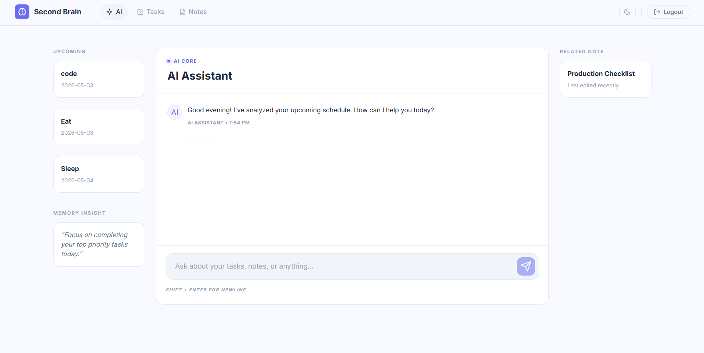
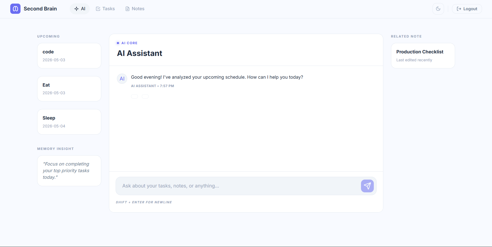
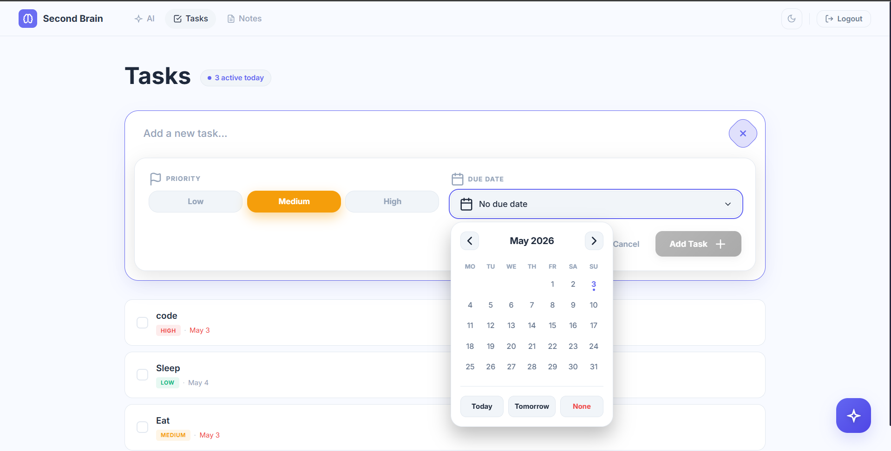
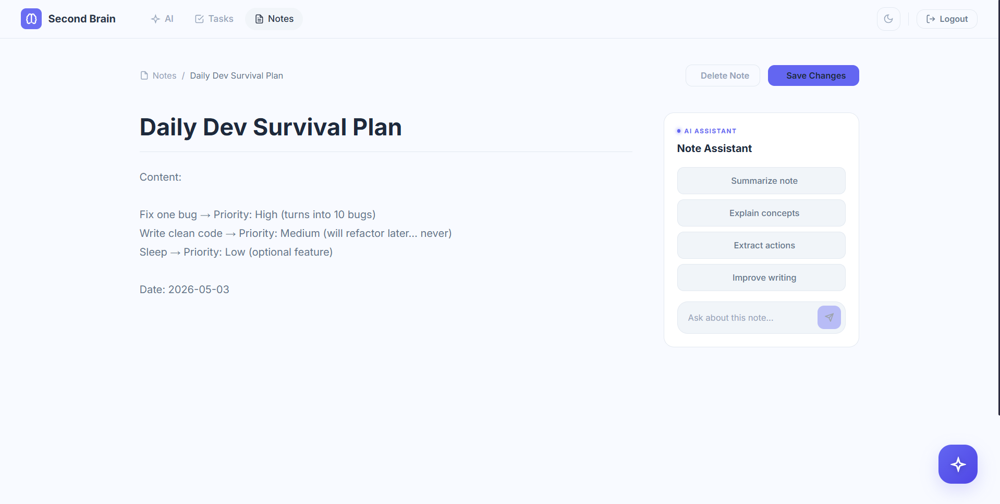
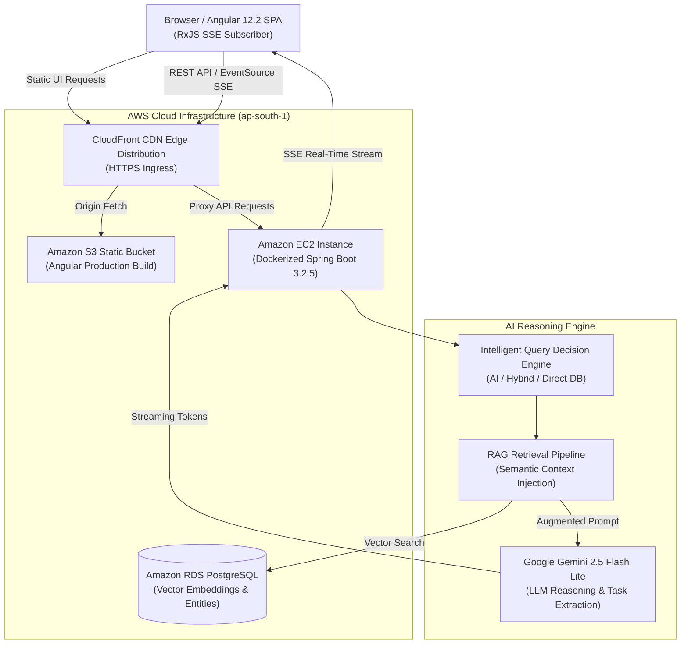
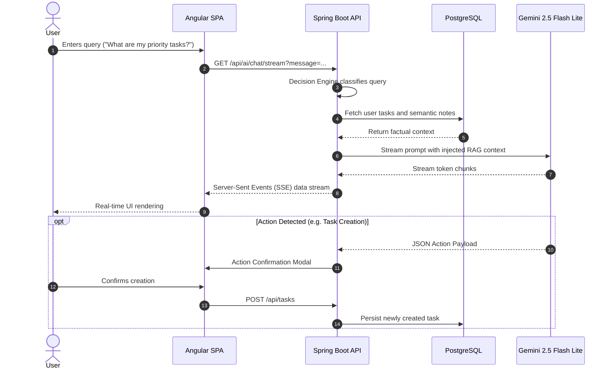

<div align="center">

# Smart-SecondBrain

**AI-Augmented Personal Life OS and Knowledge Engine**

<p align="center">
  <a href="https://adoptium.net/"></a>
  <a href="https://spring.io/projects/spring-boot"></a>
  <a href="https://angular.dev/"></a>
  <a href="https://www.postgresql.org/"></a>
  <a href="https://ai.google.dev/"></a>
  <a href="https://aws.amazon.com/cloudfront/"></a>
  <a href="LICENSE"></a>
  <a href="https://d3icm4v3pyidtw.cloudfront.net"></a>
</p>

<p align="center">
  Intelligent personal productivity system with RAG contextual retrieval,<br>
  real-time SSE token streaming, and autonomous task execution.
</p>

<p align="center">
  <a href="https://d3icm4v3pyidtw.cloudfront.net">
    <strong>Explore the Live Interactive Platform</strong>
  </a>
</p>

<p align="center">
  <a href="#quick-flow">Quick Flow</a> •
  <a href="#visual-showcase">Visual Showcase</a> •
  <a href="#system-architecture">Architecture</a> •
  <a href="#core-architectural-engines">Core Engines</a> •
  <a href="#getting-started">Getting Started</a> •
  <a href="#api-endpoints">API Contract</a>
</p>

</div>

---

> [!NOTE]
> **Evolutionary Project: AI Augmentation of SecondBrain**
> This repository is **Smart-SecondBrain**, the AI-augmented evolution of **[secondBrain](https://github.com/tanmayythakare/secondBrain)**.
> While `secondBrain` provides the core distraction-free productivity engine with an interactive knowledge graph, `Smart-SecondBrain` introduces an intelligent reasoning layer powered by **Google Gemini 2.5 Flash Lite**, **semantic vector embeddings in PostgreSQL**, and a **Retrieval-Augmented Generation (RAG)** pipeline. For a lightweight, zero-AI variant, see **[lifeos](https://github.com/tanmayythakare/lifeos)**.

---

## Quick Flow

```
User Query  →  Decision Engine  →  RAG Context Retrieval  →  Gemini 2.5 Reasoning  →  SSE Stream & Task Action
```

---

## Visual Showcase

| AI Assistant with RAG Context | Agentic Task Creation Action |
| :---: | :---: |
|  |  |
| **Priority-Tiered Task Management** | **Note Workspace with AI Copilot Sidebar** |
|  |  |

---

## System Architecture

### High-Level Topology



### RAG Query & Execution Flow



---

## Core Architectural Engines

### 01. RAG AI Assistant and Decision Engine
* **Contextual Retrieval-Augmented Generation**: Unlike basic chatbots, the assistant queries your actual database entities and vector embeddings before prompting the model, eliminating hallucinations.
* **Intelligent Query Classification**: Automatically evaluates user queries to route them through pure AI, direct database lookup, or hybrid RAG retrieval.
* **Real-Time Token Streaming**: Server-Sent Events (SSE) stream tokens continuously to the Angular client for zero-latency perceptual response times.
* **Persistent Conversation History**: Multi-turn dialogue context maintained across sessions and server restarts.

### 02. Agentic Task Orchestration
* **Conversational Task Creation**: The AI parses natural speech to propose structured tasks with due dates and priority tiers, requiring one-click confirmation before DB persistence.
* **Priority-Tiered Lifecycle**: Tasks categorize into `LOW`, `MEDIUM`, and `HIGH` priority with color-coded badges, overdue highlights, and active-today telemetry.
* **State Lifecycle**: Strict state progression (`TODO` ➔ `IN_PROGRESS` ➔ `DONE`).

### 03. Knowledge Base and Semantic Note Intelligence
* **Rich Markdown Editor**: Clean note authoring environment supporting title, tags, and formatting.
* **In-Context AI Copilot**: Dedicated sidebar offering one-click actions:
  * Summarize lengthy notes.
  * Extract concrete action items and checklist deliverables.
  * Explain complex topics.
  * Polish and improve writing clarity.
* **Automated Vector Embedding**: Notes auto-vectorize upon save for instant semantic indexing.

### 04. Hardened Infrastructure and CI/CD
* **Dual-Tier AWS Deployment**: Angular frontend hosted on Amazon S3 and distributed via CloudFront edge locations; Spring Boot backend containerized on EC2.
* **Agentless Deployment Automation**: GitHub Actions pipeline compiles Docker images, publishes to AWS ECR, and executes rolling container redeployment via AWS Systems Manager (SSM) without opening inbound SSH ports.
* **Stateless Security**: JWT tokens with per-user data tenancy preventing cross-account data leakage.

---

## Tech Stack

### AI and Intelligence
| Technology | Version | Purpose |
| :--- | :--- | :--- |
| **Google Gemini** | 2.5 Flash Lite | Core reasoning LLM for RAG responses and action parsing |
| **Server-Sent Events** | SSE Protocol | Unidirectional real-time token streaming to frontend |
| **pgvector / Embeddings** | — | Semantic vector indexing stored in PostgreSQL |

### Backend
| Technology | Version | Purpose |
| :--- | :--- | :--- |
| **Java** | 17 LTS | Core programming language |
| **Spring Boot** | 3.2.5 | Application framework and dependency injection |
| **Spring Security** | 6.x | Stateless JWT authentication and authorization |
| **Spring Data JPA** | 3.x | Object-Relational Mapping (Hibernate) |
| **SpringDoc OpenAPI** | 2.3.0 | Swagger UI API contract documentation |
| **PostgreSQL** | 14+ | Relational data and vector store |

### Frontend
| Technology | Version | Purpose |
| :--- | :--- | :--- |
| **Angular** | 12.2 | Component-based Single Page Application framework |
| **TypeScript** | 4.3 | Type-safe client development |
| **RxJS** | 6.6 | Reactive EventSource SSE stream handling |
| **CSS3** | — | Responsive modern dark theme styling |

### Cloud and Delivery
| Service | Region | Purpose |
| :--- | :--- | :--- |
| **AWS CloudFront** | Global Edge | CDN proxying frontend static assets and backend API |
| **Amazon S3** | ap-south-1 | Static web asset storage |
| **Amazon EC2** | ap-south-1 | Container runtime for backend API |
| **Amazon ECR** | ap-south-1 | Private Docker image registry |
| **AWS SSM** | ap-south-1 | Agentless container rollout and restart |
| **GitHub Actions** | — | Automated continuous integration and deployment pipeline |

---

## Getting Started

### Prerequisites
* Java 17 JDK or higher
* Node.js 18+ (with npm)
* PostgreSQL 14+
* Google Gemini API key ([Google AI Studio](https://aistudio.google.com/))

### 1. Clone the Repository
```bash
git clone https://github.com/tanmayythakare/Smart-SecondBrain.git
cd Smart-SecondBrain
```

### 2. Configure the Database
```sql
CREATE DATABASE secondbrain_db;
CREATE USER secondbrain_user WITH PASSWORD 'your_password';
GRANT ALL PRIVILEGES ON DATABASE secondbrain_db TO secondbrain_user;
```

### 3. Configure Backend Environment
Set environment variables or edit `backend/src/main/resources/application.properties`:
```properties
spring.datasource.url=jdbc:postgresql://localhost:5432/secondbrain_db
spring.datasource.username=secondbrain_user
spring.datasource.password=your_password

jwt.secret=your_super_secret_jwt_key_at_least_32_characters_long

app.ai.gemini.key=your_gemini_api_key_here
app.ai.gemini.model=gemini-2.5-flash-lite
app.ai.gemini.endpoint=https://generativelanguage.googleapis.com/v1beta/models/
```

### 4. Run the Backend
```bash
cd backend
mvn spring-boot:run
```
The backend API initializes on **http://localhost:8080**.

### 5. Run the Frontend
Open a new terminal window:
```bash
cd frontend/secondbrain-frontend
npm install
npm start
```
Access the application at **http://localhost:4200**.

---

## API Endpoints

### Authentication
| Method | Endpoint | Description | Auth Required |
| :--- | :--- | :--- | :---: |
| `POST` | `/api/auth/register` | Register new account | No |
| `POST` | `/api/auth/login` | Authenticate and obtain JWT token | No |

### AI Assistant (RAG)
| Method | Endpoint | Description | Auth Required |
| :--- | :--- | :--- | :---: |
| `GET` | `/api/ai/chat/stream` | Stream real-time token response via SSE | Yes |
| `GET` | `/api/ai/history` | Retrieve persistent conversation history | Yes |
| `DELETE` | `/api/ai/history` | Clear user chat history | Yes |

### Task Management
| Method | Endpoint | Description | Auth Required |
| :--- | :--- | :--- | :---: |
| `GET` | `/api/tasks` | List all tasks for user | Yes |
| `POST` | `/api/tasks` | Create new task | Yes |
| `PUT` | `/api/tasks/{id}` | Update task details or status | Yes |
| `DELETE` | `/api/tasks/{id}` | Delete task | Yes |

### Knowledge Notes
| Method | Endpoint | Description | Auth Required |
| :--- | :--- | :--- | :---: |
| `GET` | `/api/notes` | List all notes | Yes |
| `POST` | `/api/notes` | Create note and trigger vectorization | Yes |
| `PUT` | `/api/notes/{id}` | Update note | Yes |
| `DELETE` | `/api/notes/{id}` | Delete note | Yes |
| `POST` | `/api/notes/{id}/ai-action` | Execute AI action (summarize, extract, refine) | Yes |

---

## Troubleshooting

<details>
<summary><strong>CORS configuration on local execution</strong></summary>

Ensure the backend configuration permits origin `http://localhost:4200`. `SecurityConfig.java` allows OPTIONS preflight requests by default. If using custom ports, update allowed origins in configuration.
</details>

<details>
<summary><strong>Gemini API rate limit or authentication errors</strong></summary>

Verify that `app.ai.gemini.key` is valid and active in Google AI Studio. Check application logs for HTTP 429 (quota exceeded) or HTTP 403 (forbidden).
</details>

<details>
<summary><strong>Client-side routing refresh in production</strong></summary>

Angular Single Page Applications rely on client-side routing. On AWS CloudFront and S3, ensure error responses for 403/404 are redirected to `/index.html` with HTTP status 200.
</details>

---

## Repository Structure

```
Smart-SecondBrain/
├── .github/                      # CI/CD GitHub Actions workflows
│   └── workflows/
│       ├── deploy.yml            # Backend build, ECR push & SSM EC2 deploy
│       └── frontend-deploy.yml   # Frontend build and S3 sync
├── backend/                      # Spring Boot 3.2.5 REST API (Java 17)
│   ├── src/main/java/            # Controllers, Services, Security, AI RAG Engine
│   ├── src/main/resources/       # application.properties and schema configs
│   ├── Dockerfile                # Multi-stage production container build
│   └── pom.xml                   # Maven dependencies
├── frontend/                     # Angular Single Page Application
│   └── secondbrain-frontend/     # Angular 12.2 source, models, and components
│       ├── src/app/              # Chat, Tasks, Notes, Auth feature modules
│       └── package.json          # Frontend dependencies
└── docs/
    └── screenshots/              # Real application UI captures and architecture
```

---

## Contributing

1. Fork the repository.
2. Create your feature branch:
   ```bash
   git checkout -b feat/your-feature-name
   ```
3. Commit your changes:
   ```bash
   git commit -m "feat: add descriptive feature summary"
   ```
4. Push to your branch and submit a Pull Request.

---

## License

This project is open-source and distributed under the **[MIT License](LICENSE)**.

---

## Author

**Tanmay Thakare**
* GitHub: [@tanmayythakare](https://github.com/tanmayythakare)
* Email: [tanmayrthakare@gmail.com](mailto:tanmayrthakare@gmail.com)
* LinkedIn: [Tanmay Thakare](https://www.linkedin.com/in/tanmaythakare)

---

<div align="center">
  <a href="https://github.com/tanmayythakare">
    
  </a>
</div>